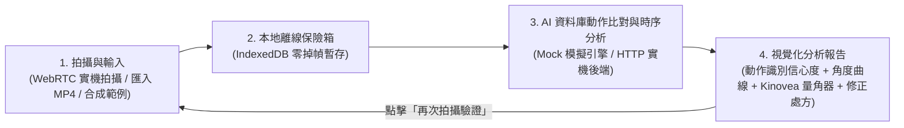

# 空手道與跆拳道動作識別評估系統 (Karate & Taekwondo Action Recognition & Biomechanics Evaluation System)

> **專題前端儲存庫** — 採用 **React 18 + TypeScript + Vite + Tailwind CSS + Dexie.js (IndexedDB) + Recharts** 建構的現代化運動生物力學視覺分析平台。
> 借鑒 **Sensei AI**（閉環教練流程與動作技術圖譜）、**JAB AI**（回合式評分與教練處方）、**Uplift Labs**（單鏡頭時序角度曲線）與 **Kinovea**（視覺量角器疊加與三階段關鍵幀定位）之設計精髓。

---

## 一、系統核心流程（為什麼這樣設計？）

本系統的核心理念為 **「透過骨骼時序特徵與標準動作資料庫進行自動比對識別，並給出可執行的運動生物力學修正建議」**：



1. **不需要事先強制死板綁定動作**：使用者在「拍攝與輸入」錄製或匯入影片後，預設採用 **「AI 自動比對識別 (`auto`)」**，由後端／分析引擎比對資料庫判定使用者正在做哪一個空手道或跆拳道動作（亦可點擊右側圖譜鎖定單一專項訓練）。
2. **離線優先（Offline-First）**：所有拍攝或匯入的視訊 Blob 會先寫入瀏覽器本地 IndexedDB（`Dexie.js`），即使展示現場網路不穩也不會遺失任何影片。
3. **前後端解耦（Adapter Pattern）**：前端已內建完整的 **Mock 生物力學模擬引擎** 與 **HTTP 實機串接介面**。在後端尚未完成前，前端即可獨立在筆電大螢幕向教授 Demo 全流程；後端完成後，只需在右上角 **「API 連線與規格」** 抽屜切換為 `HTTP 實機後端` 即可無縫串接。

---

## 二、快速啟動指南

### 1. 環境需求
- **Node.js** `>= 18.x`（建議 `20.x LTS`）
- **npm** `>= 9.x`

### 2. 安裝與執行指令

```bash
# 1. 安裝相依套件
npm install

# 2. 啟動本地開發伺服器 (預設 http://localhost:5173)
npm run dev

# 3. 執行單元測試 (驗證 API 資料合約與生物力學指標計算)
npx vitest run

# 4. 打包正式環境版本 (含 TypeScript 嚴格型別檢查)
npm run build
```

---

## 三、前端已完成功能與三大核心畫面

### 1. 拍攝與輸入工作台 (`src/features/recorder/RecordWorkspace.tsx`)
- **Uplift Labs 風格極簡大取景窗**：
  - 支援筆電鏡頭與手機前後鏡頭切換（`FlipHorizontal`）、**3 秒倒數開拍**（方便操作者退回鏡頭中央擺好架勢）、以及 **取景全身對位參考線**。
  - **錄影期間零重繪（Zero Re-render）效能保護**：計時器封裝於獨立葉子組件 [`RecordingTimer.tsx`](src/features/recorder/components/RecordingTimer.tsx)，避免每秒狀態更新導致 `<video>` 預覽閃爍或掉幀。
- **多元影像來源**：
  - **實機鏡頭錄製**（自動偵測 `video/webm;codecs=vp9` 或 `video/mp4`）
  - **匯入本地影片**（支援 `.mp4` / `.webm` / `.mov`，自動擷取影片時長與中間幀縮圖）
  - **一鍵產生範例影片**（利用 Canvas 動態渲染含骨骼關鍵點與角度標記的合成測試影片，無須開鏡頭也能測試全套流程）
- **Sensei AI 閉環捷徑列**：拍攝或匯入完成後，底部立即浮現 **「立即識別並查看報告」** 按鈕，一鍵完成分析並跳轉至報告頁。
- **Sensei AI 識別模式與動作技術圖譜**：
  - 預設為 **「AI 自動比對識別」**。
  - 提供 **`全部 8` | `空手道 5` | `跆拳道 5`** 分類篩選，點擊任一動作卡片可檢視其標準關節角度區間與評估重點，或鎖定該動作進行專項練習。

### 2. 動作影片庫 (`src/features/vault/VideoVault.tsx`)
- 自動透過 `useLiveQuery` 即時監聽本地 IndexedDB `videos` 資料表。
- 顯示影片來源（`實機拍攝` / `檔案匯入` / `範例模擬`）、檔案大小、拍攝時間、以及五種狀態燈號（`待分析`、`上傳中`、`辨識中`、`已完成`、`失敗`）。
- 支援依 **動作類別（含「待識別動作」與 8 項標準動作）** 及 **分析狀態** 進行篩選，並支援 **「批次識別與評估」** 與原片預覽。

### 3. 視覺化分析報告儀表板 (`src/features/analysis/AnalysisDashboard.tsx`)
- **JAB AI 回合式極簡數據指標列（Metric Strip）**：
  - 一眼掌握：**資料庫比對識別動作（含信心度 `%`）**、**動作總評分与等級（`Grade A–D`）**、**標準角度達成率（`%`）**、**核心軸線穩定度** 與 **最大角度偏差（`°`）**。
- **Kinovea 慢動作角度疊加檢視器**：
  - 內建 **Kinovea 風格關節量角器與錯誤部位高亮 SVG 疊加層**（左上角可自由切換 `角度標記 開/關`）。
  - 左下角即時顯示當前影格的 **實際關節角度 vs. 資料庫標準區間** 與正負偏差度數。
  - **動作三階段關鍵幀快速定位（Keyframes）**：一鍵跳轉至 **`蓄力期 (Preparation)`**、**`擊打頂點 (Impact)`**、**`收勢回防 (Recovery)`**。
  - 支援 `0.25x` / `0.5x` / `1x` 慢動作倍速切換、$\pm 0.1\text{s}$ 逐幀微調（亦支援鍵盤 `Space` 播放/暫停、`←` / `→` 逐幀步進）。
- **Uplift Labs 關節角度時序曲線圖 (`JointAngleChart.tsx`)**：
  - 使用 Recharts `ComposedChart` 繪製 **綠色標準角度區間帶（Standard Band）**、**白色實際關節角度曲線**、**目前播放時間垂直同步線** 與 **紅色瑕疵標記點**。
  - 點擊圖表上任一時間點或下方瑕疵卡片，左側影片會自動同步跳轉（Seek）至該影格。
- **Sensei AI / JAB AI 教練評估總結、表現亮點與具體修正處方 (`DefectTimelineList.tsx`)**：
  - 除了列出異常時間點與角度數值外，每一項瑕疵皆附帶 **具體可執行的「修正建議（Prescription）」**（告訴使用者身體哪個部位該如何調整）。
  - 右上角提供 **「再次拍攝驗證」** 按鈕，點擊後帶著該動作鎖定狀態返回拍攝頁，形成完整的「拍攝 $\rightarrow$ 診斷 $\rightarrow$ 修正 $\rightarrow$ 再驗證」閉環體驗。

---

## 四、內建 8 大空手道與跆拳道標準動作資料庫 (`ACTION_METADATA`)

定義於 [`src/types/martial-arts.types.ts`](src/types/martial-arts.types.ts)，結合國內外運動生物力學文獻設定之標準峰值角度區間：

| 動作代碼 (`ActionType`) | 動作名稱 | 國際術語 (日 / 韓文) | 所屬武術 | 類別 | 主要觀測關節 (`primaryJoints`) | 標準峰值角度區間 |
| :--- | :--- | :--- | :--- | :--- | :--- | :--- |
| `straight_punch` | **正拳攻擊** | *Gyaku-Zuki* / 逆突き | 空手道 | 直線拳法 | `right_elbow`, `torso`, `hip` | 右肘伸展 `165°–178°` |
| `age_uke` | **上段格擋** | *Jodan Age-Uke* / 上段揚げ受け | 空手道 | 防禦格擋 | `right_elbow`, `left_elbow`, `torso` | 格擋肘角 `92°–112°` |
| `gedan_barai` | **下段格擋** | *Gedan-Barai* / 下段払い | 空手道 | 防禦格擋 | `left_elbow`, `hip`, `torso` | 終點肘角 `150°–168°` |
| `front_kick` | **前踢** | *Mae-Geri* / *Ap-Chagi* (앞차기) | 空手道・跆拳道 | 直線腿法 | `right_knee`, `hip`, `torso` | 彈踢膝伸展 `165°–178°` |
| `roundhouse_kick` | **迴旋踢** | *Dollyo-Chagi* (돌려차기) / *Mawashi-Geri* | 跆拳道 | 迴旋腿法 | `right_knee`, `hip`, `torso` | 鞭甩膝伸展 `160°–176°` |
| `side_kick` | **側踢** | *Yeop-Chagi* (옆차기) / *Yoko-Geri* | 空手道・跆拳道 | 直線腿法 | `left_knee`, `hip`, `torso` | 側踹膝伸展 `162°–177°` |
| `back_kick` | **轉身後踢** | *Dwit-Chagi* (뒷차기) / *Ushiro-Geri* | 跆拳道 | 旋轉腿法 | `right_knee`, `hip`, `torso` | 後踹膝伸展 `160°–175°` |
| `axe_kick` | **下壓踢** | *Naeryeo-Chagi* (내려차기) / *Kakato-Otoshi* | 跆拳道 | 高空劈腿 | `right_knee`, `hip`, `torso` | 劈落膝伸展 `165°–179°` |

---

## 五、專案目錄結構說明

```text
c:\專題
├── src/
│   ├── app/
│   │   └── App.tsx                       # 頂部導覽列與三大工作區路由狀態管理
│   ├── types/
│   │   └── martial-arts.types.ts         # 【前後端核心型別合約】所有動作、關節、分析結果與 IndexedDB 資料結構
│   ├── db/
│   │   ├── database.ts                   # Dexie.js 本地 IndexedDB 資料庫定義 (videos, analyses 雙資料表)
│   │   └── repositories/
│   │       └── video.repo.ts             # 封裝影片與分析報告的 CRUD 操作
│   ├── services/
│   │   ├── apiClient.interface.ts        # IAnalysisApiClient 統一介面、JSON 欄位驗證正規化器與生物力學計算函式
│   │   ├── analysisClient.factory.ts     # 雙模式工廠 (動態切換 Mock 模擬引擎 / HTTP 實機後端，持久化於 localStorage)
│   │   ├── mockAnalysis.service.ts       # 內建 8 大動作生物力學時序模擬引擎與 Canvas 合成骨架範例產生器
│   │   ├── httpAnalysis.client.ts        # 實機後端 HTTP Client (XHR multipart/form-data 支援真實上傳進度回報)
│   │   └── __tests__/                    # Vitest 單元測試
│   ├── features/
│   │   ├── recorder/                     # 【畫面 1】拍攝與輸入工作台 (CameraPreview, RecordingTimer, useMediaStream, useMediaRecorder)
│   │   ├── vault/                        # 【畫面 2】動作影片庫 (VideoVault)
│   │   └── analysis/                     # 【畫面 3】視覺化分析報告儀表板 (AnalysisDashboard, JointAngleChart, DefectTimelineList)
│   ├── shared/
│   │   ├── components/
│   │   │   ├── ApiConnectionDrawer.tsx   # 右上角「API 連線與規格」抽屜 (一鍵切換 Mock/HTTP 與複製 JSON 規格)
│   │   │   └── ToastContainer.tsx        # 全域通知組件
│   │   ├── hooks/
│   │   │   ├── useNetworkStatus.ts       # 即時偵測 Online / Offline 狀態
│   │   │   └── useObjectUrl.ts           # 嚴格管理 Blob URL 生命週期，防止記憶體洩漏 (Memory Leak)
│   │   └── utils/
│   │       └── videoMedia.utils.ts       # 匯入影片時自動解析時長與擷取縮圖工具
│   ├── main.tsx                          # React 掛載入口
│   └── index.css                         # Modern Minimalism 深色中性設計系統樣式
└── package.json
```

---

## 六、給後端／AI 組員的 API 串接規格（Backend API Contract）

當後端（例如 Python FastAPI / Flask + MediaPipe / YOLOv8-Pose + DTW / ST-GCN）開發完成後，請實作以下兩個端點，即可在前端右上角點擊 **「API 連線與規格」** 切換為 **「HTTP 實機後端」** 直接連通：

### 1. 健康檢查端點：`GET /api/v1/health`
- **回應 (`200 OK`)**：
```json
{
  "status": "ok",
  "message": "Pose estimation & action recognition backend ready"
}
```

### 2. 影片上傳與動作識別評估端點：`POST /api/v1/analyze`
- **Request 格式**：`multipart/form-data`
  - `file` (`Binary File`)：使用者拍攝或匯入的 `.webm` / `.mp4` 影片檔
  - `videoId` (`string`)：前端產生的影片唯一識別碼
  - `duration` (`string`)：影片秒數（例如 `"3.2"`）
  - `actionType` (`string`, 選填)：若為 `"auto"`，代表請後端透過資料庫比對自動識別動作類別；若為特定動作代碼（如 `"roundhouse_kick"`），代表使用者鎖定專項訓練。

- **Response 格式 (`200 OK`, `application/json`)**：
  前端 [`validateAnalysisResponse()`](src/services/apiClient.interface.ts) 會自動驗證並補齊選填預設值，標準結構如下：

```json
{
  "analysisId": "ana-20261019-001",
  "videoId": "vid-1729330000",
  "actionType": "roundhouse_kick",
  "confidence": 95.8,
  "totalScore": 83,
  "grade": "B",
  "duration": 3.2,
  "feedbackSummary": "系統經資料庫特徵比對識別為「跆拳道・迴旋踢 (Dollyo-Chagi)」（信心度 95.8%）。提膝高度充足，但在彈踢瞬間（約 1.6 秒）右膝伸展角度差約 9 度。",
  "strengths": [
    "起腿提膝（Chamber）高度與摺疊角度精準達標，具備良好隱蔽性",
    "上半身防禦架勢於起腿階段保持穩定，未出現大幅後仰失衡"
  ],
  "keyframes": {
    "preparation": 0.8,
    "impact": 1.6,
    "recovery": 2.3
  },
  "defects": [
    {
      "id": "def-1",
      "timestamp": 1.6,
      "jointName": "right_knee",
      "currentValue": 151,
      "standardRange": [160, 176],
      "message": "踢擊瞬間小腿鞭甩延伸不足，膝關節角度低於標準下限。",
      "prescription": "修正建議：在支撐腳腳掌旋轉至 150° 後再啟動小腿鞭甩，利用股四頭肌爆發收縮將膝角延伸至 165° 以上。",
      "severity": "critical"
    }
  ],
  "angleTimeSeries": {
    "jointName": "right_knee",
    "points": [
      { "time": 0.0, "actualAngle": 68, "standardMin": 60, "standardMax": 78 },
      { "time": 0.8, "actualAngle": 115, "standardMin": 110, "standardMax": 128 },
      { "time": 1.6, "actualAngle": 151, "standardMin": 160, "standardMax": 176 },
      { "time": 2.3, "actualAngle": 102, "standardMin": 95, "standardMax": 115 }
    ]
  },
  "allJointSeries": [
    {
      "jointName": "right_knee",
      "points": []
    },
    {
      "jointName": "hip",
      "points": []
    },
    {
      "jointName": "torso",
      "points": []
    }
  ]
}
```

#### 支援的欄位列舉值：
- **`actionType`**：`'straight_punch'` | `'age_uke'` | `'gedan_barai'` | `'front_kick'` | `'roundhouse_kick'` | `'side_kick'` | `'back_kick'` | `'axe_kick'`
- **`jointName`**：`'left_elbow'` | `'right_elbow'` | `'left_knee'` | `'right_knee'` | `'hip'` | `'torso'`
- **`severity`**：`'minor'` | `'moderate'` | `'critical'`
- **`grade`**：`'A'` | `'B'` | `'C'` | `'D'`
